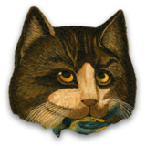
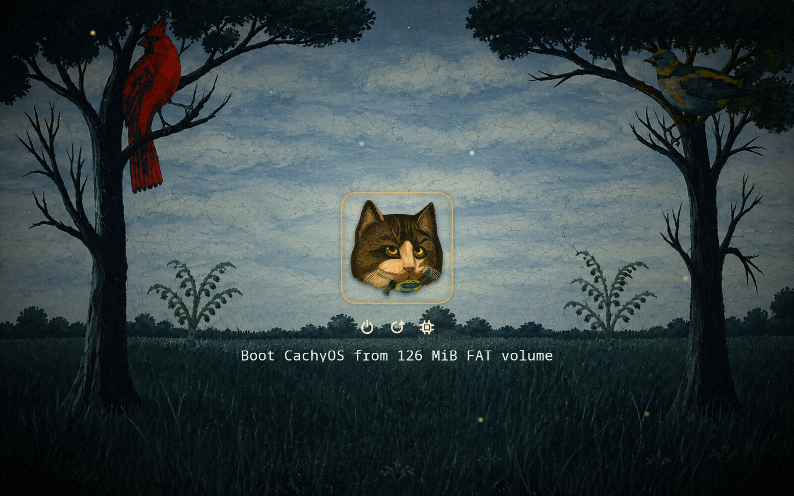
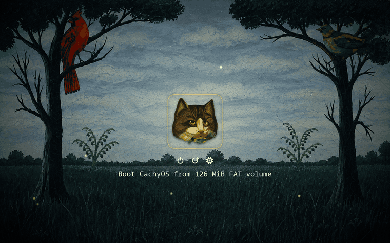
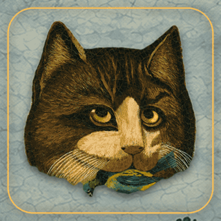
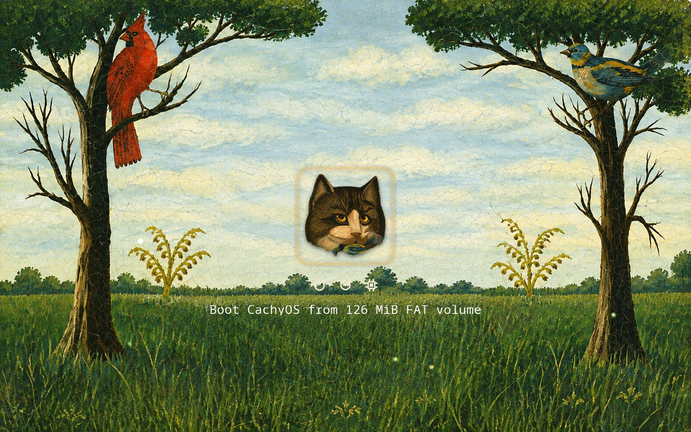
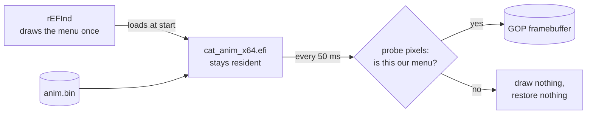

<p align="center">
  
</p>

<h1 align="center">refind-cat</h1>

<p align="center">
  <b>An animated night-meadow theme for rEFInd.</b><br>
  A painted cat with a bird in its mouth blinks at you while the machine decides what to boot.
</p>

<p align="center">
  
  
  
  
  
</p>

<p align="center">
  
</p>

rEFInd has no animation support, so this project adds some: a 12 KB boot-service driver that rEFInd loads on its own
and that paints a blinking cat, a rocking bird, fireflies and twinkling stars straight into the framebuffer. The theme
itself is the [rEFInd](https://www.rodsbooks.com/refind/) look you would expect (a background, icons, a font, a
selection frame), drawn from one painting.

> **Status:** verified in QEMU with OVMF (KVM, FAT32 image on an NVMe disk), including an automated end-to-end test of
> the installer. If you try it on real hardware, an issue with the result is very welcome.

## Install

```sh
curl -fsSL https://raw.githubusercontent.com/TheSiriuss/refind-cat/main/install.sh | sudo bash
```

It asks before it changes anything. You need rEFInd (0.14) already installed and booting your machine; the installer does not set it up.

<details>
<summary><b>What the installer does to your system</b></summary>

<br>

1. Finds the rEFInd directory on your EFI System Partition (`/boot`, `/boot/efi` or `/efi`).
2. Backs up that directory and `refind.conf` to `/var/backups/refind-cat/<timestamp>/`, together with an `uninstall.sh`.
3. Copies `themes/cat/` and `drivers_x64/cat_anim_x64.efi` into it.
4. Appends one marked block to `refind.conf` (re-running replaces it, never duplicates it):

   ```
   # >>> refind-cat >>>
   include themes/cat/theme.conf
   # <<< refind-cat <<<
   ```

It does **not** touch the firmware boot entries (`efibootmgr`), does not replace the rEFInd binary, and with Secure Boot
enabled it installs the theme only, because the animation driver is unsigned.

Options (pass them with `... | sudo bash -s -- --dry-run`): `--dry-run`, `--yes`, `--no-driver`, `--esp DIR`.

</details>

**Uninstall:** `sudo bash /var/backups/refind-cat/<timestamp>/uninstall.sh`, or from a checkout `sudo scripts/uninstall.sh`.
It removes the block, the theme and the driver and leaves `refind.conf` exactly as it was.

### Use the cat as your system's logo

Give your entry the icon (all of `os_cachyos`, `os_arch`, `os_linux`, `os_endeavouros` and `os_manjaro` are the cat, so
auto-detected entries pick it up too):

```
menuentry "CachyOS" {
    icon   /EFI/refind/themes/cat/icons/os_cachyos.png
    loader /vmlinuz-linux-cachyos
    ...
}
```

The animation needs the screen to run at **1920×1200**. If rEFInd does not pick that mode by itself, add
`resolution max` (or `resolution 1920 1200`) to `refind.conf`. At any other resolution the theme is still shown, scaled,
and the animation simply stays off.

## Preview

<table>
  <tr>
    <td width="62%"></td>
    <td width="38%"></td>
  </tr>
</table>

| What moves | How |
| --- | --- |
| **Blink** | every 2.5–5.5 s, now and then twice in a row; the eyelids are painted with fur cloned from the picture itself |
| **Bird** | rocks about the point where the cat holds it, ±4° over 2.8 s |
| **Fireflies and stars** | 18 fireflies and about 60 stars, drawn only on parts of the screen rEFInd never touches |

The cat holds still when another entry is selected, and everything stops the moment the screen is no longer the menu.

<details>
<summary><b>A second background: the painting untouched</b></summary>

<br>



`VARIANT=day ./build.sh` builds the theme on the painting exactly as it is (only scaled to 1920×1200). The icons are
harder to read on it, which is why the night grade is the default.

</details>

## How it works

rEFInd reads its config and loads every driver in `drivers_x64/` *before* it draws anything, and UEFI keeps boot-services
timers running while rEFInd waits for a key. `cat_anim_x64.efi` is a boot-service driver that uses both:



- **Pre-composited patches.** The blink and the bird are small rectangles (110×38 and 138×87 px) rendered offline over the
  exact background, selection frame and drop shadow, so at runtime a frame is just a `memcpy` into the framebuffer.
- **Writes go straight to memory.** The driver never calls `GOP->Blt`, so it cannot re-enter a blit that rEFInd is in
  the middle of when the timer fires.
- **Save-under for the ambient layer.** Fireflies and stars remember the pixels below them and put them back, and are
  only ever placed where rEFInd draws nothing.
- **It checks what it is drawing on.** Ten pixels of the background and eight pixels of the selection frame are compared
  with the expected colours on every tick. Selection moves to another icon? The tile is left alone. rEFInd cleared the
  screen to start Linux? The driver stays silent and never writes a pixel of its own back.
- **Integer only.** No libc, no floating point, no SSE: a few hundred lines of freestanding C, built with `clang` and
  `lld-link` as a PE32+ image with the EFI boot-service-driver subsystem.

### Safety

It runs inside the firmware, so it is built to fail quietly:

| Situation | What happens |
| --- | --- |
| `anim.bin` missing, wrong resolution, no usable GOP | does nothing; the static theme stays |
| screen is not the themed menu | does nothing |
| the driver crashes the firmware | an NVRAM counter (`CatAnimGuard`) is raised at start and cleared after 2 s of animating, or at `ExitBootServices`; **two unconfirmed starts in a row disable the driver**, so the third boot is plain rEFInd. Re-arm it with `scripts/anim-reset.sh` |
| the OS is starting | a handler on `ExitBootServices` marks the driver dead before the firmware tears down |
| Secure Boot is on | the installer leaves the unsigned driver out |

The crash guard is exercised by a build that faults on purpose (`./driver/build.sh crash`): two crashes, then the third
boot comes up clean.

## Build from source

```sh
./build.sh                       # night variant -> dist/EFI/refind
VARIANT=day DIST=/tmp/day ./build.sh
./build.sh --cutout              # also redo the cat cut-out from art/source/painting.png (slow)
```

Needs `python3` (a venv with `numpy`, `opencv-python-headless`, `pillow` is created in `.venv`), and `clang` with `lld`
for the driver. The whole pipeline is deterministic: the same inputs give byte-identical files.

The art is generated from two source images in `art/source/`: `withoutcat.png` (the meadow, which becomes the
background) and `painting.png` (the same scene with the cat, which the cat is cut out of with GrabCut). The cat is then
split into a head layer and a bird layer so the bird can move on its own.

## Test

Everything runs in QEMU, nothing touches a real disk. Needs `qemu-system-x86_64`, OVMF, `mtools`, `dosfstools` and
ImageMagick.

```sh
test/e2e.sh        # a plain rEFInd ESP -> the real installer -> boot -> pixel checks -> uninstall -> config restored
test/record.sh dist/EFI/refind out/   # stills and GIFs like the ones above
```

`e2e.sh` checks that a second install does not duplicate the config block, that uninstalling restores `refind.conf`
byte for byte, that the themed menu comes up, that the picture is actually moving, and that nothing of the theme is left
on screen after the entry is launched.

## Layout

```
install.sh            one-line installer (downloads the repo, runs scripts/install.sh)
build.sh              regenerates dist/ from art/
dist/EFI/refind/      the ready-to-copy theme, anim.bin and the driver
driver/               cat_anim.c, the animation driver, and its build script
art/                  the generators: background grade, theme assets, animation data
art/cutout/           cat extraction (GrabCut) and the head / bird split
scripts/              install, uninstall, backup-esp, anim-reset
test/                 QEMU harness and the end-to-end test
docs/                 the images in this README
```

## Notes

- rEFInd builds the entry label itself (`Boot <name> from <volume>`); it cannot be changed from a theme.
- The theme sets `showtools` to power, reboot and firmware. rEFInd 0.14 does not clear unused slots of that list, so the
  rest are filled with `csr_rotate`, which does nothing outside a Mac.
- `hideui hints,badges` is set; remove it from `art/theme.conf` if you want the key hints back.

## Credits

- [rEFInd](https://www.rodsbooks.com/refind/) by Rod Smith.
- Menu font: glyphs rasterised from [Noto Sans Mono](https://fonts.google.com/noto/specimen/Noto+Sans+Mono) (SIL Open Font License 1.1).
- `art/source/` holds the painting the theme was made from, included so that the build is reproducible.
